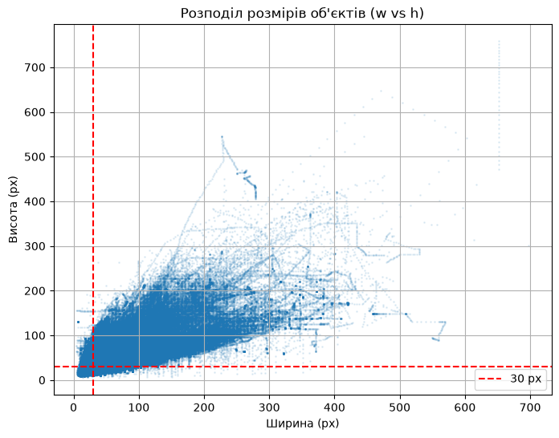
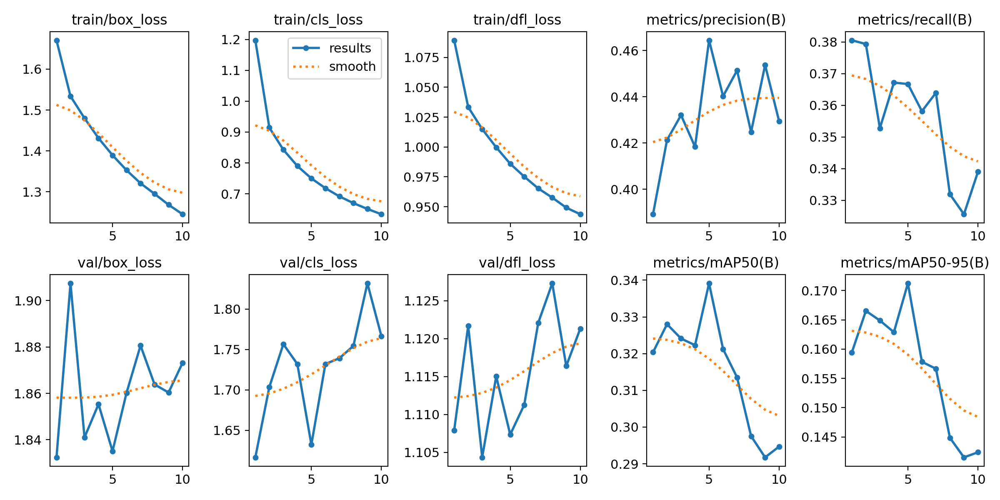
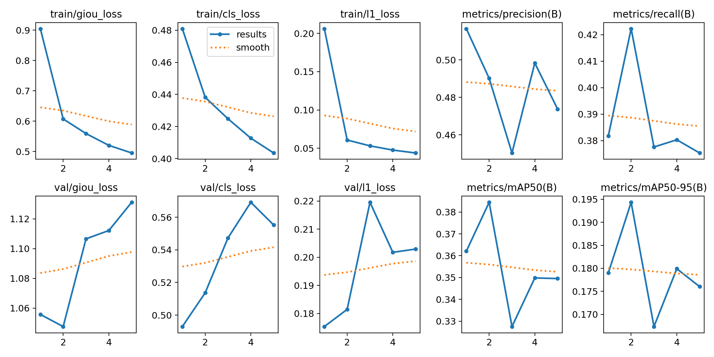

## Important

The last commit was made on 2026-11-16, but it only affects `report.md` and `images/`, which is allowed, because report deadline is at todays date. The last commit to code was made 2026-11-15

## Introduction

In this homework we train a deep learning model capable of identifying objects on a video. We did try different approaches, including One-stage Anchor-free YOLOv8n and Query-based RT-DETR.

## Method

Lets break down steps done in this lab.

### Data preparation

The code was launched in a Kaggle Notebook, so there was no need to download dataset. Then we analyzed objects sizes on all the photos and created a plot.



It shows that many objects have sizes 10-30px. By default model would compress image to about 640x640px. Little objects would become difficult to identify so we increased image size setting in models to 1024px but it slowed performance. Also photos from the same sequence are correlated and could cause dataleakage if one gets to train set and other to validation set, so we divide dataset by sequences.

Next we mask ignored areas with (128,128,128) gray color, so the model doesnt get penalized for mis identification.

The masked images were created to /kaggle/working because input folder is read only

### One-stage Anchor-free YOLOv8n

Ultralitics is hardcoded to names images and labels, so for it to work we renamed `images_masked/` and `labels_masked/` folders back to `images/` and `labels/`. Also we tried to use 2 notebooks: first would prepare data and use *save and commit* button to share this data and the second would use it as input. But it did not allow to rename the folders in a second notebook, so we switched to 1 notebook variant. Later I understood that input and working folders can have folders with the same name inside, so we could just not create `images_masked/` and `labels_masked/` but create `images/` and `labels/` and there would be no need to rename them back, and 2 notebooks variant would work.

Also 2 GPUs couldnt do the job because of the bug with PyTorch, so only one was used for all the calculations in this homework.

YOLO means You only look once. It does look at image and analyze it only one time. Also it does not use predetermined sizes for boxes and guesses the box size by itself. so it is anchor free one stage. It is nano version so is camparably fast. Still on one GPU with 10 epochs and 1024 imgsize it took about one hour to train it.

Results are thje following mAP50 ~ 0.339 and inference 3.6 ms a frame
This means that model was not very good at detecting objects but take in account a lot of images were 10-30px in size this is a normal result for so light model.c Inference time is so low because it is one stage and very light. Also important is that in testing a model we used conf = 0.25 which helped detecting very little objects.

### Query-based RT-DETR.

RT-DETR is also a part of ultralytics library so it had a similar setup. But it works not by going through the image simultaneously but makes fixed query number. It also uses transformer and attention. The queries are like agents that try not to copy each other. So it worked better on 640px images than we think YOLO would, because it has no problems with two objects being to close.

Because it is a transformer it worked slower and inference time is about 16 ms per frame. To train it in a reasonable time we didi not increase image size to 1024 and reduced epochs number to 5. To detect little objects as efficiently as YOLO we dropped confidence level on test stage to 0.20.

This model ran in the same notebook as YOLO, but it would be good to create separate notebook for data processing and for each model, so we could train models in parallel.

mAp50 score was 0.384 which is still more than YOLO with better image precision and more epochs. But RT-DETR required 2.5 hours to train. Wo could increase image size and number of epochs but it would require a lot more time, however could give better results.

### Launch

To launch the code you will need to clone this repository via:

```bash
git clone git@github.com:OleksandrTsybrivskyi/ucu-ai-hw-2.git
```

Then create new notebook on kaggle competition and import `notebooks/01_eda_and_validation.ipynb`. Then just go through all the cells in order and launch them. The results will be saved in `kaggle/working/submission.csv` for YOLOv8n and `kaggle/working/submission_final.csv` for RT-DETR.

<!-- 
Inline math works with single dollars: $f(x) = \sigma(Wx + b)$. Display math uses double dollars:

$$
\mathcal{L}(\theta) = -\frac{1}{N}\sum_{i=1}^{N} y_i \log \hat{y}_i
$$

Code blocks are highlighted:

```python
def accuracy(y_true, y_pred):
    return (y_true == y_pred).mean()
``` -->

## Results

Here are the results for YOLOv8n



We see that after 5 epoch `val/box_loss` `val/cls_loss` and `val/dfl_loss` started growing which caused `metrics/mAP50(B)` and `metrics/mAP50-95(B)` to drop. It means model started overfitting. To solve the problem we should only use weights from epoch with the best metrics when testing. But we used weights from `best.pt` file, which are weights from the best epoch.

---

Here are the results for RT-DETR



Here we see similar problem with overfitting. `val/giou_loss` `val/cls_loss` and `val/l1_loss` started growing after 2nd epoch, and `metrics/mAP50(B)` and `metrics/mAP50-95(B)` started dropping after 2nd epoch, which shows the same problem of overfitting, which is solved by taking weights from the best epoch.


<!-- 
| Model    | Accuracy | F1   |
|----------|----------|------|
| Baseline | 0.71     | 0.68 |
| Ours     | 0.84     | 0.82 |

Images go into the `images/` folder:

 -->

## Conclusion

In summary we can say that transformer query model was more efficient than one stage anchor free. It happened because it was more effiicient at distinguishing close objects and because transformers are better for cases with big dataset and when we have a lot of compute. Transformer model trained 150% more time than one stage anchor free. On lower dataset YOLO would be more efficient i guess.

